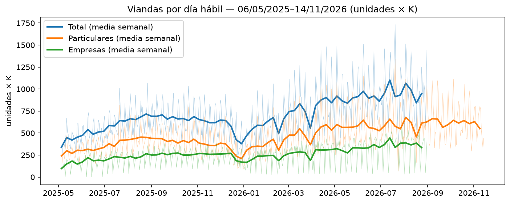
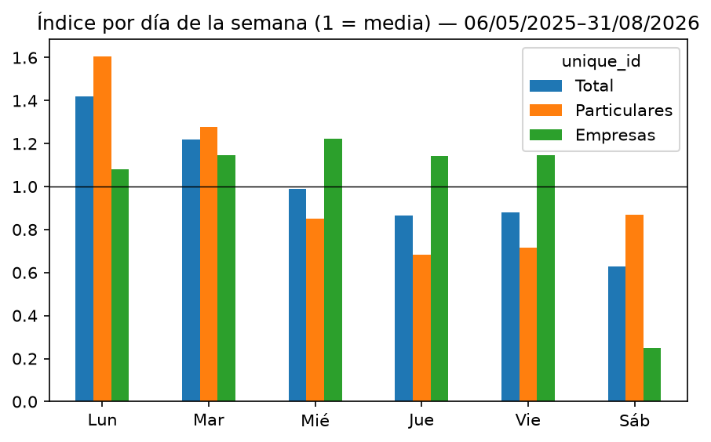
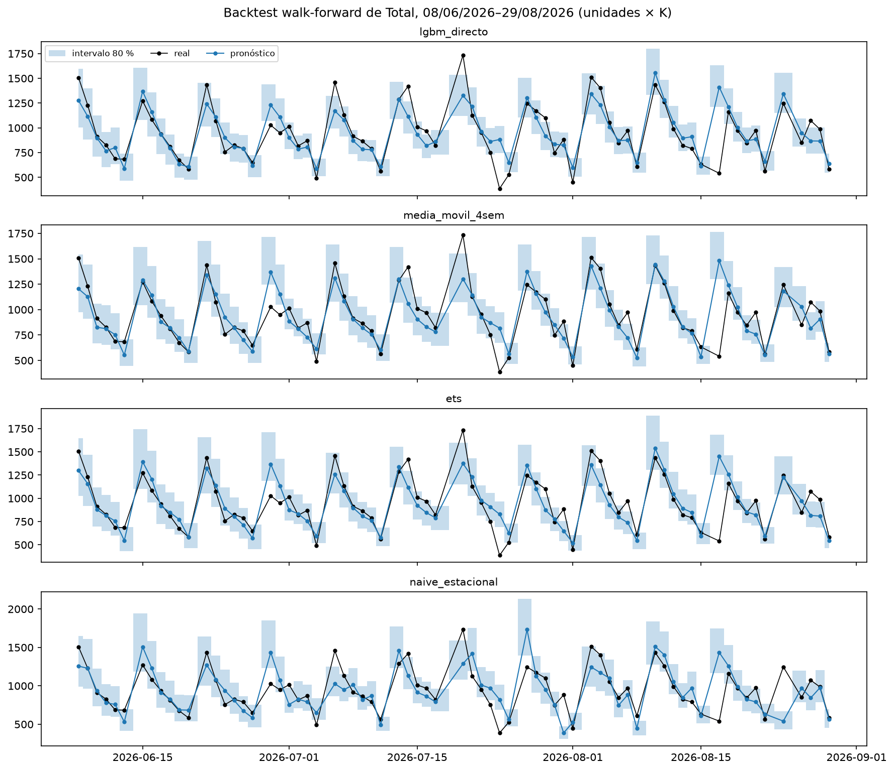
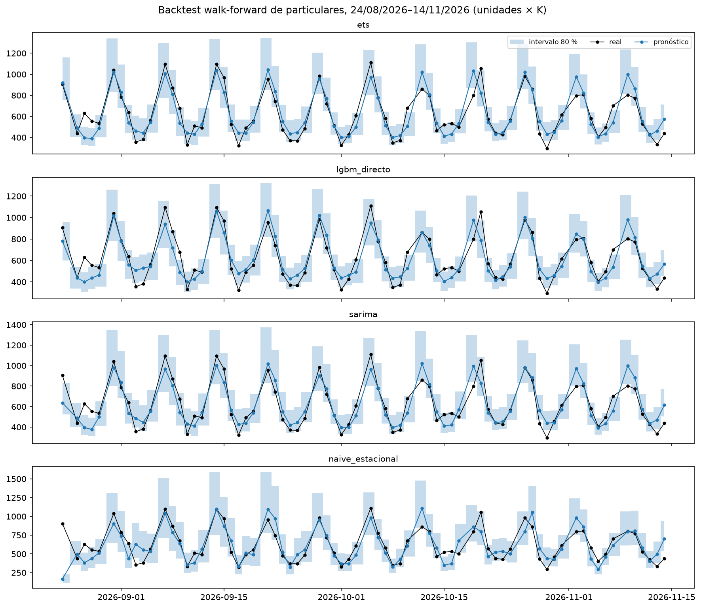
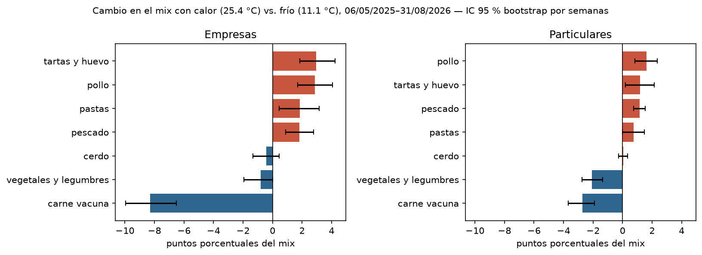
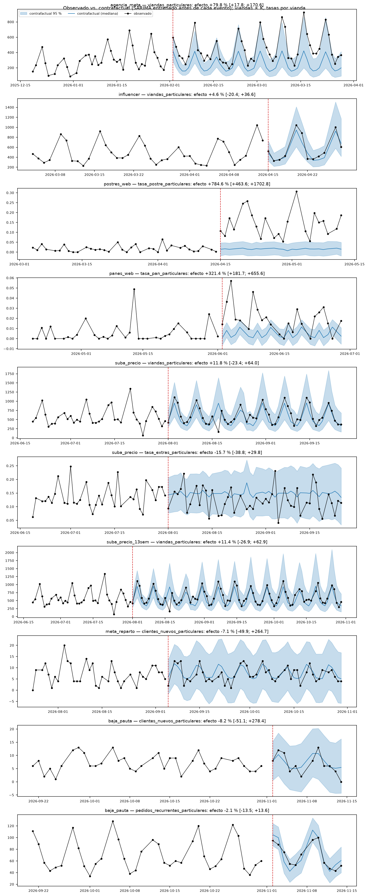
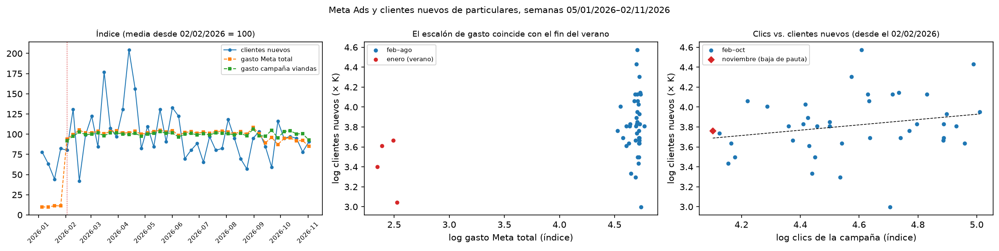
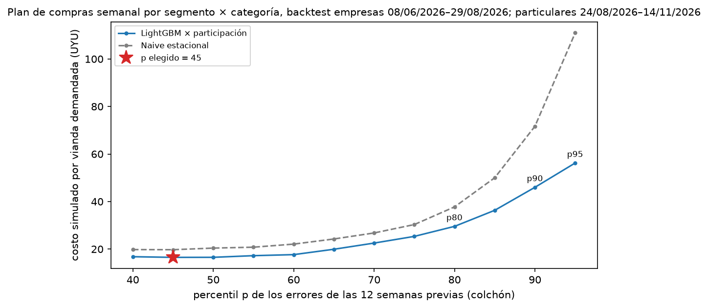

# Resultados — Del pedido al plato

Pronóstico de la demanda de Viandas Hotel del Prado, efecto de eventos y de la pauta en Meta, y plan de compras.

Datos: Total y empresas 06/05/2025–31/08/2026 (407 días hábiles); particulares 06/05/2025–14/11/2026 (472 días hábiles). Empresas no está disponible desde septiembre 2026 (solo llegaron los exports de individuales de septiembre a noviembre; noviembre cortado en la última semana completa). Backtest walk-forward del Total: semanas 08/06/2026–29/08/2026; de particulares: semanas 24/08/2026–14/11/2026 (12 orígenes, uno por sábado). Unidades multiplicadas por una constante secreta K (anonimización). Las métricas relativas (MASE, WAPE, coberturas, %) no cambian con K.

Todo se regenera con `python main.py all`. Las tablas están en `reports/tables/`, las figuras en `reports/figures/`, y el porqué de cada decisión en `reports/decisiones.yaml`.

## 1. Patrones (análisis exploratorio)

- La serie en nivel no es estacionaria (ADF p = 0,66); con una diferencia estacional de 6 días sí lo es (ADF p < 0,001). Por eso SARIMA usa D = 1 con período 6.
- Perfil semanal opuesto: el lunes los particulares están en 1,60 veces su media y el sábado las empresas en 0,25.
- Feriados laborables (se abre): Total −30 % [−37; −22], Particulares −18 % [−27; −9], Empresas −46 % [−55; −35].

Efectos de calendario: regresión lineal de log(y) en días hábiles (06/05/2025–31/08/2026) con día de la semana, tendencia, feriado laborable, víspera y día después de un cierre, y verano (enero). Efecto en % sobre el nivel:

| Serie | Variable | Días | Efecto [IC 95 %] | p |
|---|---|---|---|---|
| Total | tendencia (por semana) | 407 | +1,0 % [+0,8; +1,1] | 0,000 |
| Total | feriado_laborable | 11 | −29,9 % [−37,3; −21,5] | 0,000 |
| Total | vispera_cierre | 7 | −21,9 % [−50,4; +22,8] | 0,284 |
| Total | post_cierre | 7 | −16,5 % [−38,4; +13,0] | 0,242 |
| Total | verano | 26 | −25,2 % [−29,3; −20,9] | 0,000 |
| Particulares | tendencia (por semana) | 472 | +0,9 % [+0,8; +1,0] | 0,000 |
| Particulares | feriado_laborable | 13 | −18,5 % [−27,3; −8,5] | 0,001 |
| Particulares | vispera_cierre | 7 | −25,7 % [−57,0; +28,6] | 0,289 |
| Particulares | post_cierre | 7 | −18,5 % [−42,0; +14,6] | 0,239 |
| Particulares | verano | 26 | −25,1 % [−30,2; −19,7] | 0,000 |
| Empresas | tendencia (por semana) | 403 | +0,9 % [+0,7; +1,2] | 0,000 |
| Empresas | feriado_laborable | 11 | −45,9 % [−55,0; −35,0] | 0,000 |
| Empresas | vispera_cierre | 7 | −13,0 % [−43,3; +33,6] | 0,525 |
| Empresas | post_cierre | 7 | −8,6 % [−34,6; +27,9] | 0,601 |
| Empresas | verano | 26 | −24,1 % [−30,0; −17,6] | 0,000 |

## 2. Pronóstico del total (backtest 08/06/2026–29/08/2026)

| Modelo | MASE | WAPE | Cobertura 80 % |
|---|---|---|---|
| LightGBM directo | 1,116 | 11,5 % | 80 % |
| Media móvil 4 semanas | 1,150 | 11,8 % | 81 % |
| ETS | 1,221 | 12,6 % | 79 % |
| SARIMA | 1,270 | 13,1 % | 80 % |
| MLP | 1,363 | 14,1 % | 76 % |
| Naive estacional | 1,578 | 16,3 % | 76 % |
| Naive | 4,077 | 41,9 % | 83 % |

LightGBM directo es el de menor MASE (1,116); Diebold-Mariano no lo separa de Media móvil 4 semanas (p = 0,55) ni de ETS (p = 0,09). Los mejores le ganan al naive estacional (p ≤ 0,007). El MLP (MASE 1,363) no le gana a LightGBM (1,116). El intervalo 80 % de todos los modelos son los percentiles 10 y 90 del error relativo (y / ŷ) del propio modelo en las 12 semanas previas al origen. Ljung-Box sobre los residuos de ETS y SARIMA (rezagos 6 y 12): p entre 0,59 y 0,87, sin autocorrelación que quede por modelar.

Diebold-Mariano (error absoluto, h = 1 a 6, backtest 08/06/2026–29/08/2026):

| Modelo 1 | Modelo 2 | DM | p | Mejor |
|---|---|---|---|---|
| LightGBM directo | Media móvil 4 semanas | −0,59 | 0,554 | LightGBM directo |
| LightGBM directo | ETS | −1,73 | 0,088 | LightGBM directo |
| LightGBM directo | SARIMA | −2,08 | 0,041 | LightGBM directo |
| LightGBM directo | Naive estacional | −5,75 | 0,000 | LightGBM directo |
| Media móvil 4 semanas | ETS | −1,02 | 0,312 | Media móvil 4 semanas |
| Media móvil 4 semanas | SARIMA | −1,67 | 0,099 | Media móvil 4 semanas |
| Media móvil 4 semanas | Naive estacional | −4,16 | 0,000 | Media móvil 4 semanas |
| ETS | SARIMA | −1,84 | 0,070 | ETS |
| ETS | Naive estacional | −4,22 | 0,000 | ETS |
| SARIMA | Naive estacional | −2,77 | 0,007 | SARIMA |

### Particulares con datos hasta noviembre (backtest 24/08/2026–14/11/2026)

El Total no se puede calcular desde septiembre (falta empresas), así que el mismo backtest se corre sobre particulares con las 12 semanas que terminan en la última semana completa:

| Modelo | MASE | WAPE | Cobertura 80 % |
|---|---|---|---|
| ETS | 0,888 | 12,4 % | 76 % |
| LightGBM directo | 0,922 | 12,9 % | 80 % |
| SARIMA | 0,972 | 13,6 % | 80 % |
| MLP | 0,987 | 13,8 % | 80 % |
| Media móvil 4 semanas | 1,030 | 14,4 % | 76 % |
| Naive estacional | 1,246 | 17,4 % | 80 % |
| Naive | 2,185 | 30,7 % | 75 % |

ETS es el de menor MASE (0,888); LightGBM directo queda en 0,922 y Diebold-Mariano no los separa (p = 0,54). MLP: 0,987; naive estacional: 1,246. Se mantiene LightGBM directo como modelo de los segmentos (decisión de la fase 5): en particulares no hay diferencia significativa con el primero.

## 3. Clima → mix de categorías

Efecto descriptivo (todo el período) de un día de calor contra uno de frío: la carne vacuna baja 8,3 pp en empresas [−9,9; −6,5] y 2,7 pp en particulares. Para pronosticar a una semana, el clima no mejora la participación media de las últimas 4 semanas (log loss por vianda, backtest 08/06/2026–29/08/2026):

| Segmento | Método | Log loss por vianda | Error absoluto medio (pp) |
|---|---|---|---|
| empresas | media_4sem | 1,6730 | 2,63 |
| empresas | multinomial | 1,6741 | 2,84 |
| empresas | multinomial_clima | 1,6746 | 2,85 |
| particulares | media_4sem | 1,7604 | 1,60 |
| particulares | multinomial_clima | 1,7617 | 1,68 |
| particulares | multinomial | 1,7618 | 1,69 |

Unidades por categoría = pronóstico del segmento (LightGBM directo) × participación prevista (backtest 08/06/2026–29/08/2026; intervalo 80 % con los errores de las 12 semanas previas):

| Nivel | Modelo | MASE | WAPE | Cobertura 80 % |
|---|---|---|---|---|
| categoria | media_4sem | 1,019 | 20,3 % | 79,9 % |
| categoria | multinomial | 1,056 | 21,1 % | 78,9 % |
| categoria | multinomial_clima | 1,057 | 21,1 % | 78,9 % |
| segmento | lgbm_directo | 1,044 | 13,9 % | 82,1 % |

## 4. Efecto de eventos (contrafactual SARIMA + placebos)

Para cada evento se ajusta un SARIMA sobre log(y) solo con los días previos (órdenes por AIC en una grilla chica, exógenas de calendario, sin constante), se pronostica el período posterior como contrafactual y se compara con lo observado (IC 95 % por simulación). Los placebos repiten el método en fechas falsas anteriores al evento. Efecto medio en el período de cada evento (particulares, datos 06/05/2025–14/11/2026). Clientes nuevos y pedidos de clientes que ya compraron van en nivel (hay días con 0) y el efecto se da en %. Efecto mínimo detectable = 2,8 × desvío de los efectos placebo (test al 5 %, potencia 80 %):

| Evento | Serie | Período | Efecto [IC 95 %] | SARIMA | Placebos significativos | Efecto mínimo detectable |
|---|---|---|---|---|---|---|
| agencia meta | viandas particulares | 02/02/2026–28/03/2026 | +80 % [+18; +171] | (1,0,1)(1,1,1)[6] | 0 de 3 | ±6 % |
| influencer | viandas particulares | 15/04/2026–28/04/2026 | +5 % [−20; +37] | (1,0,1)(1,1,1)[6] | 2 de 8 | ±57 % |
| postres web | tasa postre particulares | 15/04/2026–12/05/2026 | +0,126 [+0,117; +0,135] por vianda | (0,0,0)(0,1,1)[6] | 0 de 7 | ±0,007 |
| panes web | tasa pan particulares | 02/06/2026–29/06/2026 | +0,015 [+0,013; +0,017] por vianda | (0,0,1)(0,1,1)[6] | 2 de 8 | ±0,005 |
| suba precio | viandas particulares | 01/08/2026–25/09/2026 | +12 % [−23; +64] | (1,0,1)(0,1,1)[6] | 0 de 4 | ±12 % |
| suba precio | tasa extras particulares | 01/08/2026–25/09/2026 | −0,023 [−0,079; +0,029] por vianda | (2,0,2)(1,1,1)[6] | 0 de 4 | ±0,006 |
| suba precio 13sem | viandas particulares | 01/08/2026–30/10/2026 | +11 % [−27; +63] | (1,0,1)(0,1,1)[6] | 0 de 1 | — |
| meta reparto | clientes nuevos particulares | 05/09/2026–30/10/2026 | −7 % [−50; +265] | (1,0,1)(0,1,1)[6] | 0 de 3 | ±30 % |
| baja pauta | clientes nuevos particulares | 02/11/2026–14/11/2026 | −8 % [−51; +278] | (1,0,1)(0,1,1)[6] | 0 de 8 | ±45 % |
| baja pauta | pedidos recurrentes particulares | 02/11/2026–14/11/2026 | −2 % [−13; +14] | (1,0,1)(0,1,1)[6] | 1 de 8 | ±19 % |

Baja de pauta de noviembre 2026 (PRELIMINAR, 12 días hábiles, 02/11–14/11/2026): clientes nuevos −8 % [−51; +278], pedidos de clientes que ya compraron −2 % [−13; +14]. Con este ruido, en dos semanas solo se distinguiría un efecto de ±45 % en los nuevos y ±19 % en los recurrentes. La fecha de inicio (02/11/2026) es un supuesto: es la primera semana con menos gasto en el Tablero (la campaña bajó ~8 %); no hay gasto diario de octubre–noviembre. Cambio de reparto entre anuncios del 05/09/2026 (8 semanas): clientes nuevos −7 % [−50; +265], 0 de 3 placebos significativos. Suba de precio con 8 semanas posteriores: viandas +12 % [−23; +64], p-placebo 0,20 con 4 placebos. Sigue PRELIMINAR: con ventanas de 8 semanas o más entran como mucho 4 placebos, así que el p-placebo no puede bajar de 0,2.

## 5. Gasto en Meta Ads (semanal, 05/01/2026–08/11/2026)

- El gasto de la campaña casi no varía desde febrero (CV 2,8 %, semanas 02/02/2026–08/11/2026, incluida la primera semana de la baja de noviembre); la variación grande sigue siendo el escalón enero → febrero (gasto total ×11,3), que coincide con el fin del verano. Los clics sí varían (CV 25,8 %, máx/mín ×2,5), por los cambios de anuncios.
- log(clientes nuevos) ~ log(gasto total) + verano: elasticidad +0,04 [−1,06; +1,15], p = 0,940, R² = 0,12 (44 semanas, 05/01/2026–08/11/2026). Correlación log gasto–verano −0,996: los dos efectos no se pueden separar.
- log(clientes nuevos) ~ log(gasto de la campaña), desde el 02/02/2026 (verano constante: sale): elasticidad −1,29 [−3,91; +1,33], p = 0,335, R² = 0,01 (40 semanas, 02/02/2026–08/11/2026).
- log(clientes nuevos) ~ log(clics de la campaña), desde el 02/02/2026: elasticidad +0,27 [+0,04; +0,49], p = 0,020, R² = 0,05 (40 semanas, 02/02/2026–08/11/2026).
- Granger con 1 rezago (fijado antes de mirar): gasto de la campaña → clientes nuevos F = 1,09, p = 0,303; clics → clientes nuevos F = 4,87, p = 0,034 (40 semanas).

Conclusión: el efecto del gasto sigue sin identificarse (el gasto casi no varió). Los clics se mueven junto con los clientes nuevos, pero no se asignan al azar (dependen de qué anuncios elige la agencia): es correlación, no causa. Recomendación que se mantiene: variar el gasto a propósito (por ejemplo, semanas alternas). La baja de noviembre es la primera variación del gasto desde febrero, pero con 2 semanas el resultado es preliminar (sección 4). No hay origen del pedido (UTM) en el export: la atribución por anuncio queda como trabajo futuro.

## 6. Plan de compras (compra semanal por segmento × categoría; backtest empresas 08/06/2026–29/08/2026; particulares 24/08/2026–14/11/2026)

Plan = pronóstico + colchón: pronóstico semanal × percentil p del cociente real / pronóstico de las 12 semanas previas (las 7 categorías del segmento juntas). Cada segmento usa sus últimas 12 semanas con datos (empresas termina en agosto). Se elige el p de menor costo simulado. Desde noviembre 2026 el sobrante y el faltante se ponderan por la proporción de XL del segmento en las 12 semanas previas a cada origen (empresas 17,1 %, particulares 5,5 % en promedio): sobrante = $200 (normal) / $260 (XL), faltante = $150 / $155 (precio $350 / $415 menos costo).

p elegido = 45 (antes: 45; con los costos fijos $200 / $150 en esta misma ventana sería 50).

| Método | p | Cobertura | Sobrante | Faltante | UYU por vianda |
|---|---|---|---|---|---|
| LightGBM × participación | 45 (elegido) | 42,9 % | 3,6 % | 6,1 % | 16,5 |
| LightGBM × participación | 80 | 82,1 % | 13,4 % | 1,3 % | 29,6 |
| LightGBM × participación | 90 | 90,5 % | 21,9 % | 0,5 % | 46,0 |
| LightGBM × participación | 95 | 94,0 % | 27,1 % | 0,2 % | 56,2 |
| Naive estacional | 45 | 46,4 % | 4,7 % | 6,7 % | 19,7 |
| Naive estacional | 80 | 81,0 % | 16,6 % | 2,3 % | 37,8 |
| Naive estacional | 90 | 90,5 % | 33,8 % | 1,3 % | 71,7 |
| Naive estacional | 95 | 92,9 % | 53,1 % | 1,0 % | 110,9 |

Por segmento con el p elegido: empresas cobertura 45,2 %, sobrante 4,8 %, faltante 5,9 %, 19,1 UYU por vianda; particulares cobertura 40,5 %, sobrante 2,8 %, faltante 6,2 %, 15,0 UYU por vianda.

Sensibilidad al costo de faltante de la vianda normal (la XL, +$5; con cada costo se vuelve a elegir p):

| Costo de faltante | p elegido | Cobertura | Sobrante | Faltante | UYU por vianda |
|---|---|---|---|---|---|
| $150 | 45 | 42,9 % | 3,6 % | 6,1 % | 16,5 |
| $300 | 60 | 57,1 % | 5,8 % | 3,8 % | 23,4 |
| $600 | 75 | 78,0 % | 11,0 % | 1,7 % | 33,1 |

El p se elige en el mismo backtest en que se evalúa, así que el costo del elegido es algo optimista.

Plan para la semana 16/11–21/11/2026, una compra semanal (porciones × K). Empresas: pronóstico con su último dato (origen 29/08/2026) puesto en esta semana [SUPUESTO: nivel y mix de agosto; no hay datos de empresas desde septiembre].

| Segmento | Categoría | Pronóstico | plan_p45 | plan_p80 | plan_p90 | plan_p95 | Datos hasta |
|---|---|---|---|---|---|---|---|
| empresas | carne vacuna | 837 | 830 | 919 | 1020 | 1111 | 29/08/2026 |
| empresas | cerdo | 85 | 85 | 94 | 105 | 114 | 29/08/2026 |
| empresas | pastas | 323 | 321 | 355 | 394 | 429 | 29/08/2026 |
| empresas | pescado | 108 | 107 | 119 | 132 | 143 | 29/08/2026 |
| empresas | pollo | 438 | 435 | 481 | 534 | 582 | 29/08/2026 |
| empresas | tartas y huevo | 185 | 184 | 203 | 226 | 246 | 29/08/2026 |
| empresas | vegetales y legumbres | 178 | 177 | 195 | 217 | 236 | 29/08/2026 |
| particulares | carne vacuna | 984 | 972 | 1097 | 1168 | 1212 | 14/11/2026 |
| particulares | cerdo | 118 | 117 | 132 | 140 | 145 | 14/11/2026 |
| particulares | pastas | 620 | 612 | 691 | 736 | 764 | 14/11/2026 |
| particulares | pescado | 254 | 251 | 283 | 301 | 313 | 14/11/2026 |
| particulares | pollo | 838 | 827 | 934 | 995 | 1032 | 14/11/2026 |
| particulares | tartas y huevo | 344 | 340 | 384 | 409 | 425 | 14/11/2026 |
| particulares | vegetales y legumbres | 283 | 280 | 316 | 337 | 349 | 14/11/2026 |

## 7. De platos a ingredientes (recetario)

Cadena de multiplicaciones: plan por segmento × categoría → reparto entre los platos de la categoría (participación de las últimas 4 semanas, normal y XL por separado) → gramos de cada ingrediente según la receta, abriendo las preparaciones base de forma recursiva (escaladas por rendimiento real) → ÷ (1 − merma) → kg por ingrediente y por proveedor. Guarniciones: 250 g por vianda en los platos con acompañamiento, repartidos según la columna Guarniciones de las últimas 4 semanas. XL sin receta propia: gramos × 1,30 [SUPUESTO].

- Semana 16/11/2026–21/11/2026: 115 ingredientes de 21 proveedores. La lista completa (con recetas, mermas y proveedores) es información comercial y queda en `reports_private/` (no se sube).
- Platos sin receta: 26 platos, 9,5 % de las viandas de las últimas 12 semanas (11,9 % del pronóstico de la semana): quedan fuera de la lista y se reportan.
- 5 ingredientes de las recetas no están en la lista de ingredientes (sin costo cargado en la app) y quedan fuera; el agua no se compra. Un ingrediente con merma negativa (la pasta seca absorbe agua) se usa con su peso seco, sin dividir.
- kg del plan sobre kg del pronóstico: plan_p45 ×0,991, plan_p80 ×1,110, plan_p90 ×1,202, plan_p95 ×1,271.

Índice por familia de ingrediente (% de los kg del pronóstico de la semana; los productos porcionados se compran por unidad):

| Familia | % de los kg | Ingredientes en unidades |
|---|---|---|
| Carnes, aves y pescado | 32,2 | 0 |
| Verdura fresca | 21,3 | 0 |
| Quesos y lacteos | 13,9 | 0 |
| Papa y frito congelado | 8,0 | 0 |
| Almacen y secos | 6,9 | 0 |
| Verdura congelada | 4,7 | 0 |
| Huevos | 3,7 | 0 |
| Fiambres y embutidos | 2,8 | 0 |
| Pastas | 2,3 | 0 |
| Condimentos | 1,8 | 0 |
| Panes y masas | 1,0 | 1 |
| Conservas escurridas | 0,8 | 0 |
| Hojas y hierbas frescas | 0,7 | 0 |
| Producto porcionado (unidad) | 0,0 | 10 |

## 8. Decisiones y por qué

| Fase | Decisión | Por qué | Quién |
|---|---|---|---|
| Datos y preparación | Período: mayo 2025 a noviembre 2026 (empresas hasta agosto) | Son todos los exports disponibles. Sin empresas el Total no se puede calcular desde septiembre: no se rellena con ceros ni se inventa, se declara. | negocio |
| Datos y preparación | Noviembre se corta en la última semana completa (14/11/2026) | Una semana incompleta subestima la demanda y rompería el backtest semanal (lunes a sábado). `Fecha de pedido` sigue sin servir: es igual a la fecha de entrega en el 100 % de septiembre y octubre y en todas menos 3 líneas de noviembre. | técnica |
| Datos y preparación | Dos platos nuevos en categorias.yaml | asignar_categoria falla si hay platos sin categoría (para no perder unidades en silencio). Pendiente de validar por Lucía. | negocio |
| Datos y preparación | La serie se indexa por fecha de entrega | La cocina y las compras se planifican para el día en que se entrega. El export no trae la hora de creación de los pedidos, así que el nowcasting con pedidos ya confirmados queda afuera. | negocio |
| Datos y preparación | Los días cerrados no existen | Un cero en un día cerrado no es demanda nula: meterlo sesgaría la media y la estacionalidad. Se verificó en los datos que en los feriados laborables hay entregas. | negocio |
| Datos y preparación | Se descartan las 7 líneas con entrega en domingo | El negocio no entrega los domingos: son errores de carga y no alcanzan para modelar un séptimo día. | negocio |
| Datos y preparación | Se eliminan los duplicados exactos | Son repeticiones del export, no pedidos nuevos. | técnica |
| Datos y preparación | El lunes 17/08/2026 se deja como está | No hay forma de reconstruir las líneas faltantes sin inventar datos. Es el peor error del backtest en todos los modelos, pero sacarlo no cambia el ranking (sensibilidad en analysis/02_total.py). | negocio |
| Datos y preparación | Datos públicos anonimizados y escalados por K | El repo es público. Con celdas por plato muy chicas se podría estimar K. MASE, WAPE, coberturas, participaciones y elasticidades no cambian con K, así que las conclusiones son las mismas. | negocio |
| Análisis exploratorio | Enero es verano (estacionalidad), no un quiebre | Es la temporada de vacaciones en Montevideo: clientes de oficina y particulares se van. Tratarla como quiebre haría creer que la serie cambió de nivel para siempre. | negocio |
| Pronóstico del total | Particulares y empresas por separado | Tienen perfiles semanales opuestos: el sábado los particulares están en 0,86 de su media y las empresas en 0,25; el lunes, 1,62 contra 1,08 (eda_dia_semana.csv). Un modelo único los mezclaría. | negocio |
| Pronóstico del total | Horizonte: la semana siguiente, con datos hasta el sábado | Es como se planifica en el negocio: el fin de semana se decide qué comprar y cocinar para la semana. | negocio |
| Pronóstico del total | Backtest walk-forward de 12 semanas | Simula exactamente el uso real: cada semana se reentrena con todo lo disponible y nunca se mira el futuro (hay tests de leakage). | técnica |
| Pronóstico del total | MASE, WAPE y cobertura del intervalo 80 %; nada de MAPE | MAPE explota con días chicos y castiga asimétricamente. MASE, WAPE y la cobertura además no cambian con el escalado K. | técnica |
| Pronóstico del total | Siete modelos, de lo más simple a lo más complejo | Son los modelos de series temporales clásicos y los de ML que se vieron en el curso (boosting y redes MLP), así que todo se puede explicar. ETS elige por AIC entre estacionalidad aditiva o multiplicativa y sin tendencia o con tendencia amortiguada. El MLP escala con media y desvío de su tramo de entrenamiento y frena con early stopping sobre las últimas 4 semanas de cada origen; semilla 42. | técnica |
| Pronóstico del total | Órdenes del SARIMA elegidos por AIC en cada origen | El log estabiliza la varianza, que crece con el nivel. D = 1 porque con una diferencia estacional de 6 días la serie es estacionaria (ADF del EDA) y d = 0 para no diferenciar de más; la constante es el crecimiento medio semana a semana. El AIC premia el ajuste y castiga los parámetros de más, y elegir en cada origen con su propio entrenamiento evita mirar el test. | técnica |
| Pronóstico del total | Intervalo 80 % con los errores recientes de cada modelo | Es el mismo método para todos los modelos, no supone ninguna distribución y solo usa semanas que ya terminaron al momento del origen (la semana pronosticada desde o − 1 termina justo en o), así que no mira el test. Se usa el cociente y no la diferencia porque la serie crece y el error escala con el nivel. 12 semanas: suficientes errores (~70 días) y lo bastante recientes. | técnica |
| Pronóstico del total | LightGBM directo como modelo del total (y de los segmentos) | Es el de menor error, aunque Diebold-Mariano no lo separa de la media móvil (p = 0,55) ni de ETS (p = 0,09) al 5 %. Los cuatro mejores le ganan con claridad al naive estacional (p ≤ 0,007). El MLP (1,363) no le gana a LightGBM y se reporta así. Con los datos nuevos, en particulares (backtest 24/08–14/11/2026) ETS queda primero (MASE 0,888) y LightGBM segundo (0,922), pero Diebold-Mariano no los separa (p = 0,54): se mantiene LightGBM. | técnica |
| Pronóstico del total | Backtest de particulares hasta noviembre 2026 | Es la única serie con datos nuevos: así se usan los tres meses sin mezclar segmentos ni inventar empresas. | técnica |
| Pronóstico del total | El clima no entra al pronóstico del total | El clima no mueve cuántas viandas se piden, sino cuáles. Además es dato observado: en producción habría que usar el pronóstico del tiempo, que agrega error. | técnica |
| Clima y mix de categorías | El clima va como hallazgo descriptivo, no como mejora del pronóstico | Con calor (25,4 °C) contra frío (11,1 °C) la carne vacuna cae 8,3 pp en empresas y 2,5 pp en particulares (IC 95 % sin cero), pero el multinomial con clima no mejora la log loss de media_4sem en el backtest: el mix reciente ya trae la estación. | negocio |
| Clima y mix de categorías | Categorías = segmento (LightGBM) × participación media de 4 semanas | MASE 1,019 en categorías contra 1,056 del multinomial (backtest 08/06–29/08/2026), y el intervalo 80 % cubre 79,9 %. Es coherente por construcción (las categorías suman el segmento) y aprovecha el mejor modelo del total. | negocio |
| Efecto de eventos | Contrafactual con SARIMA sin constante + placebos | Con D = 1 la constante es una deriva semanal que, proyectada 4–8 semanas, inventa efectos: con constante, los placebos de la agencia daban −20 y −15 % significativos. Si los placebos también encuentran efecto, el método no es confiable para ese evento. | técnica |
| Efecto de eventos | El efecto de la agencia de Meta es una cota superior | Está confundido con la vuelta del verano: no hay febrero–marzo previos para aprender ese rebote, y los placebos de influencer con fecha en feb–abr 2026 dan entre +4 y +25 % (ninguno significativo). | negocio |
| Efecto de eventos | La suba de precio sigue siendo preliminar | La regla era sacarle la etiqueta solo si los placebos lo permiten. Con ventanas de 8 semanas o más entran como mucho 4 placebos (las ventanas no pueden cruzar otros eventos ni un enero sin enero previo), así que el p-placebo no puede bajar de 1/5 = 0,2. Además, la ventana se superpone con el cambio de reparto de Meta del 05/09. | técnica |
| Efecto de eventos | Efecto mínimo detectable con los placebos | Con pocas semanas posteriores un efecto no significativo no quiere decir 'sin efecto': el EMD dice qué tamaño se podría haber visto con ese ruido. | técnica |
| Efecto de eventos | Cambio de reparto (05/09) y baja de pauta (02/11): sin efecto detectable | La baja es chica hasta ahora (campaña ~9.100 → 8.400 UYU en la semana del 02/11, −8 %) y hay solo 12 días hábiles posteriores. Que ni nuevos ni recurrentes se muevan es coherente con una baja que todavía no se nota; hay que volver a medir cuando haya más semanas y el gasto diario. | técnica |
| Gasto en Meta Ads | El efecto del gasto en Meta no está identificado | Desde febrero el gasto casi no varía (CV 2,8 % hasta el 08/11/2026); la información está en el escalón ene→feb, confundido con el verano. Regresión log(clientes nuevos) ~ log(gasto total) + verano (44 semanas): elasticidad +0,04 [−1,06; +1,15], p = 0,94 (antes, con 34 semanas, −1,11, p = 0,32: el signo cambió y sigue sin ser significativo), correlación −0,996 entre log gasto y verano. Con el gasto de la campaña desde febrero (40 semanas): −1,29 [−3,91; +1,33], p = 0,33. Granger gasto de la campaña → clientes nuevos: p = 0,303. | negocio |
| Gasto en Meta Ads | Los clics se mueven con los clientes nuevos, pero es correlación | Los clics varían (CV 26 %) porque la agencia cambia anuncios; el gasto no. Pero los clics no se asignan al azar: el anuncio que la agencia elige puede ir con la estación o con la oferta. Es una señal, no un efecto causal; la recomendación de variar el gasto a propósito se mantiene. Sin UTM en el export, la atribución por anuncio queda como trabajo futuro. | técnica |
| Plan de compras | Plan = pronóstico + colchón | Es la idea más simple que corrige el pronóstico con sus propios errores recientes, sin suponer una distribución y sin mirar el test (solo semanas ya terminadas). Elegir p en el mismo backtest es algo optimista; se declara. | técnica |
| Plan de compras | Una compra semanal por segmento × categoría | Es como se compra en el negocio: el fin de semana para toda la semana. | negocio |
| Plan de compras | El colchón junta las 7 categorías del segmento | Hay un error por serie y semana: con 12 semanas, el percentil 90 y el 95 serían ambos el máximo. Juntando las 7 categorías hay 84 errores. | técnica |
| Plan de compras | Faltante = margen perdido, ponderado por XL, con sensibilidad | Como sobrar duele más que faltar, conviene comprar un poco menos que lo esperado (p < 50). Si quedarse corto hace perder al cliente, el faltante cuesta más y conviene comprar más. | negocio |
| De platos a ingredientes | Del plan a los ingredientes con el recetario, solo multiplicaciones | No agrega teoría: son las cuentas que hace la cocina. Mapeo plato vendido → receta en config/recetas_map.yaml (86 por nombre normalizado, 4 a mano, 30 sin receta); 26 platos sin receta suman 9,5 % de las viandas de las últimas 12 semanas y quedan fuera. Los 5 ingredientes sin match en la lista de ingredientes (marcados $0 en la app) y el agua quedan fuera. | técnica |
| De platos a ingredientes | XL sin receta propia = normal × 1,30 | Es el mismo +30 % que se usa para el costo de la XL ($260). | técnica |
| De platos a ingredientes | La lista de compras completa no se sube | Es información comercial del negocio. El % por familia no depende de K ni permite reconstruir recetas. | negocio |
